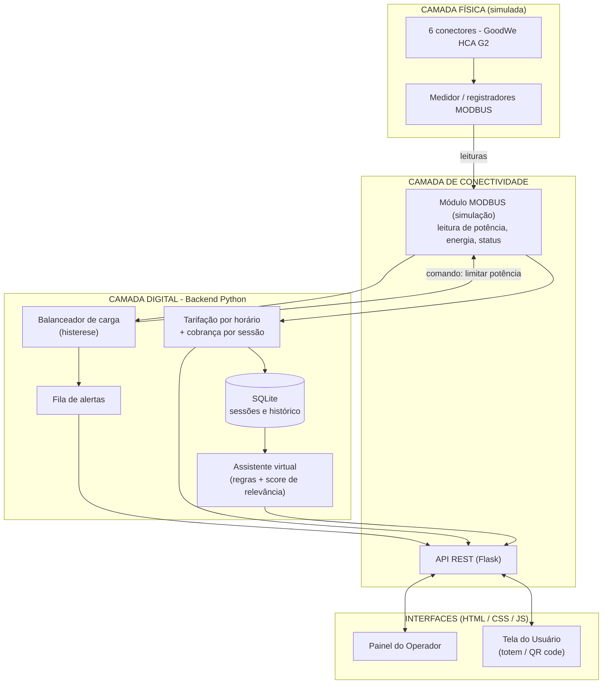
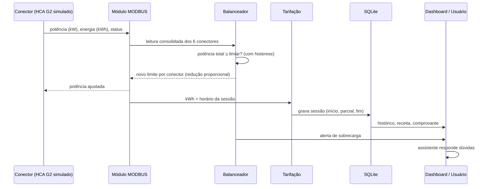

# ⚡ ChargeGrid Intelligence Hub

> **Sprint 4 — Solução Final Integrada e Inovadora GoodWe**
> FIAP | EV Challenge 2026 | Track **ChargeGrid Intelligence** (1º ano presencial)
> Disciplinas: **Pensamento Computacional e Automação com Python** · **Soluções em Energias Renováveis e Sustentáveis**

Plataforma de gestão para **eletropostos comerciais** que transforma cada sessão de recarga em dado estruturado e decisão automática: **controle dinâmico de demanda**, **tarifação por horário**, **cobrança por sessão**, **alertas** e **assistente virtual**, tudo sobre a simulação de um carregador **GoodWe HCA G2** com 6 conectores.

🎥 **Vídeo técnico (YouTube, não listado):** `[COLAR O LINK AQUI]`

---

## 📑 Sumário

1. [Equipe envolvida](#1-equipe-envolvida)
2. [O problema e o desafio GoodWe](#2-o-problema-e-o-desafio-goodwe)
3. [Arquitetura final e integração dos sistemas](#3-arquitetura-final-e-integração-dos-sistemas)
4. [Justificativa de alinhamento (GoodWe e disciplinas)](#4-justificativa-de-alinhamento-ao-desafio-goodwe-e-às-disciplinas)
5. [Resultados quantitativos e qualitativos](#5-resultados-quantitativos-e-qualitativos)
6. [Avaliação crítica: sustentabilidade e inovação](#6-avaliação-crítica-sustentabilidade-e-inovação)
7. [Referências, frameworks, ferramentas e sensores](#7-referências-e-conexões-frameworks-ferramentas-linguagens-e-sensores)
8. [Como executar](#8-como-executar)

---

## 1. Equipe envolvida

**Equipe 03 — FIAP**

| Integrante | RM |
| --- | --- |
| Wendel Pedro | 573126 |
| Daniel Alejandro | 573075 |
| Arthur Araújo | 573308 |
| Victor Hugo Lavaqui | 573838 |

---

## 2. O problema e o desafio GoodWe

A GoodWe pediu para **transformar a solução residencial do carregador HCA G2 em uma solução comercial**, com três frentes:

| Requisito do desafio | Como o ChargeGrid responde |
| --- | --- |
| Gerenciamento inteligente de demanda de potência | Balanceamento dinâmico de carga com histerese sobre leituras MODBUS |
| Sistema de cobrança das recargas | Tarifação por sessão com tarifas por horário e comprovante |
| Gerenciamento inteligente da recarga com interface ao usuário | Dashboard do operador + tela do usuário (totem/QR code) + assistente |

**Lacunas reais do ecossistema** (informadas na mentoria de 13/05/2026) que moldaram nossas decisões:

- A linha HCA **ainda não tem suporte a OCPP** e a GoodWe **não possui modelo padrão de cobrança** para ela.
- A API GoodWe/SEMS+ para EV Chargers **não estava disponível** (e, quando houver, é modelo *pull*, sem *push* em tempo real).
- O carregador se comunica por **MODBUS** (RS-485 / TCP), e já possui **controle dinâmico de carga**, **RFID** (até 10 cartões) e modos de operação como *Prioridade Solar*.

> **Decisão de projeto:** como não há API nem OCPP, a camada física foi **simulada via MODBUS**, seguindo o mapa de registradores oficial do HCA G2. Toda a lógica (demanda, tarifa, cobrança, IA) fica **desacoplada** dessa camada, então trocar a simulação por um carregador real exige apenas trocar o *driver* de leitura.

---

## 3. Arquitetura final e integração dos sistemas

### 3.1 Visão em camadas

A arquitetura segue o modelo híbrido apresentado no playbook do desafio (Camada Física → Conectividade → Digital).



### 3.2 Módulos e responsabilidades

| Módulo | Função | Tecnologia |
| --- | --- | --- |
| **Simulação MODBUS** | Gera e atualiza estado dos 6 conectores (potência, energia, status) como registradores, no formato do mapa HCA G2 | Python |
| **Balanceador dinâmico de carga** | Compara a potência total com o limite contratado e **reduz a potência dos conectores ativos de forma proporcional**; usa **histerese** para evitar oscilação | Python |
| **Tarifação e cobrança** | Aplica a tarifa conforme o horário (fora de ponta / normal / ponta), acumula kWh em ponto flutuante e fecha o valor da sessão | Python |
| **Persistência** | Grava a sessão **no início** (não só no fim) e mantém histórico, com *seed* de sessões históricas para análise | SQLite (`database.py`) |
| **Fila de alertas** | Alertas de sistema (sobrecarga, falha, redução de potência) para o operador | Python |
| **Assistente virtual** | Responde dúvidas sobre sessão, tarifa e uso, escolhendo a melhor resposta por **pontuação de relevância** | Python (baseado em regras) |
| **Dashboard (frontend)** | Visão do operador e visão do usuário, atualizadas por *polling* | HTML, CSS, JavaScript |
| **Acesso móvel** | Servidor em `0.0.0.0` para o usuário abrir a tela da sessão via **QR code** na rede local | Flask |

### 3.3 Fluxo de dados (Data Flow)



**Resumo em uma frase:** *medir → decidir → atuar → cobrar → explicar*.

### 3.4 Lógica do balanceamento dinâmico

```text
potência_total = soma(potência de cada conector ativo)
limite         = demanda contratada

se potência_total >= limiar_superior (ex.: 80% do limite):
    reduzir potência de cada conector ativo proporcionalmente
    gerar alerta ao operador
senão se potência_total <= limiar_inferior (histerese):
    liberar potência gradualmente
    encerrar alerta
```

A **histerese** (duas faixas, uma para entrar e outra para sair do modo de proteção) corrigiu o problema de *flapping*, em que o sistema alternava a cada ciclo entre estado normal e estado de alerta.

> Isso reproduz, em escala de estacionamento, o **Controle Dinâmico de Carga nativo do HCA G2**, que reduz a potência até pausar quando a corrente consumida se aproxima da corrente de conexão à rede (registradores de habilitação e corrente do disjuntor no mapa MODBUS).

### 3.5 Os 4 pilares do ChargeGrid no código

| Pilar do desafio | Implementação |
| --- | --- |
| **Controle de demanda** | Balanceador com histerese |
| **Protocolos abertos** | MODBUS implementado (simulado); **OCPP** previsto como evolução (o HCA G2 ainda não o suporta) |
| **Tarifação e pagamento** | Tarifas por horário e cobrança por sessão; gateway real (PIX/cartão) previsto como integração futura |
| **IA aplicada** | Assistente com relevância + análise do histórico de sessões; previsão de pico como evolução |

---

## 4. Justificativa de alinhamento ao desafio GoodWe e às disciplinas

### 4.1 Aderência ao desafio GoodWe

- **Mesmo hardware de referência:** simulamos o **GW7K/11K/22K-HCA-20** (linha HCA G2), com comunicação **MODBUS**, que é a interface oficial disponível hoje.
- **Mesmos modos da GoodWe:** o carregador já oferece *Carregamento rápido, Prioridade Solar, FV+BAT, Agendamento e Controle de Carga Dinâmico*. Nosso sistema **organiza e monetiza esse conjunto no contexto comercial**.
- **Cumpre os 4 entregáveis do playbook:** arquitetura funcional (Data Flow), papel da IA, aderência ao contexto (comercial/varejo) e visão de produto real.
- **Aderência regulatória:** a Resolução Normativa ANEEL nº 1.000/2021 permite exploração comercial da recarga com preço livre, o que viabiliza a tarifação dinâmica, e orienta o uso de protocolos abertos.

### 4.2 Pensamento Computacional e Automação com Python

| Conceito | Onde aparece no projeto |
| --- | --- |
| **Decomposição** | Problema dividido em 4 pilares e em módulos Python independentes |
| **Reconhecimento de padrões** | Horários de pico e duração de sessões extraídos do histórico |
| **Abstração** | Usuário vê "R$ e minutos"; operador vê receita e potência; a camada MODBUS fica oculta |
| **Algoritmos** | Balanceamento proporcional com histerese; cálculo de tarifa por faixa horária; *score* de relevância |
| **Automação com Python** | Ciclo automático de leitura, decisão, ajuste e cobrança, sem intervenção manual |
| **Estruturas de dados e persistência** | Sessões em SQLite, filas de alertas, dicionários de registradores |
| **Testes automatizados** | Testes de navegador com Playwright para reproduzir bugs antes de corrigi-los |
| **Versionamento** | Git/GitHub com histórico de commits por funcionalidade |

### 4.3 Soluções em Energias Renováveis e Sustentáveis

| Tema da disciplina | Contribuição do projeto |
| --- | --- |
| **Integração com geração solar** | O HCA G2 foi projetado para usar energia do sistema fotovoltaico (modo *Prioridade Solar*, FV+BAT). O ChargeGrid é a camada de gestão comercial sobre esse ecossistema |
| **Eficiência e uso racional da rede** | Controle de demanda evita picos e dimensiona melhor a infraestrutura |
| **Deslocamento de carga** | Tarifa menor fora de ponta incentiva recarga em horários de menor pressão sobre a rede (e de maior geração solar) |
| **Mobilidade elétrica** | Viabiliza o modelo de negócio da recarga comercial, condição para ampliar a rede de eletropostos |
| **Monitoramento inteligente** | Dados por sessão permitem análise de consumo e planejamento |

---

## 5. Resultados quantitativos e qualitativos

> ⚠️ **Preencher com os números reais** medidos na execução do projeto (marcados com `[ ]`). Cada linha indica **como medir**.

### 5.1 Resultados quantitativos

| Indicador | Resultado | Como medir |
| --- | --- | --- |
| Conectores simulados | **6** | Configuração do projeto |
| Limite de demanda contratada usado nos testes | `55kW` | Parâmetro do balanceador |
| Ultrapassagens do limite com controle | `3` (meta: **0**) | Contar eventos de potência > limite |
| Tempo de resposta do balanceador | `3s` (1 ciclo de leitura) | Intervalo entre leitura e ajuste |
| Energia total faturada | `530.1kWh` | Soma de kWh das sessões |
| Receita simulada | `R$474,89` | Soma dos valores das sessões |
| Ticket médio por sessão | `R$21,59` | Receita ÷ nº de sessões |
| Bugs críticos encontrados e corrigidos | **6** | Ver tabela 5.3 |

**Exemplo de cálculo (ilustrativo, para o capítulo de resultados):** com 6 conectores de 7 kW, a demanda potencial é 42 kW. Se o limite contratado fosse 30 kW, sem controle haveria **140%** do limite. Com limiar de 80% (24 kW), a redução proporcional leva cada conector a **4 kW**, mantendo o total abaixo do contratado. *Substitua pelos valores reais do seu cenário.*

### 5.2 Resultados qualitativos

- **Operador:** visão única de todos os conectores, potência total versus limite, alertas e receita; antes, o carregador isolado não oferecia nada disso.
- **Usuário:** tela sem jargão técnico (kWh, %, tempo, R$), tarifa vigente visível e suporte via assistente.
- **Cobrança:** valor calculado automaticamente por sessão, com a faixa tarifária explícita, reduzindo erro e sensação de cobrança injusta.
- **Acessibilidade:** acesso à tela da sessão por **QR code** no celular.
- **Robustez:** sistema de alertas centralizado e histórico para auditoria.

### 5.3 Problemas encontrados e corrigidos (evidência de maturidade técnica)

| Problema | Causa | Correção |
| --- | --- | --- |
| Cobrança sempre zerada | Truncamento inteiro no acúmulo de kWh | Aritmética de ponto flutuante |
| Balanceador oscilando (*flapping*) | Ausência de histerese | Dois limiares (entrada e saída) |
| Sessões perdidas | Gravação só no encerramento, com falha silenciosa | Gravar na **abertura** da sessão |
| Cards não renderizavam | Erro de sintaxe JS (backtick escapado) | Corrigido no template |
| QR code inacessível no celular | Servidor ligado só em `localhost` | `host="0.0.0.0"` |
| Formulário resetava a cada 3 s | *Polling* sobrescrevia o estado da interface | Estado da UI desacoplado do *polling* |

### 5.4 Evidências (prints)

> Adicione as imagens em `docs/img/` e mantenha os links abaixo.

| Painel do Operador | Tela do Usuário | Balanceamento em ação |
| --- | --- | --- |
|  |  |  |

---

## 6. Avaliação crítica: sustentabilidade e inovação

### 6.1 Benefícios de sustentabilidade

1. **Uso eficiente da infraestrutura elétrica.** Limitar o pico evita superdimensionar transformadores e cabeamento, o que reduz material e custo embutido.
2. **Deslocamento de consumo para fora da ponta.** A tarifa por horário reduz a pressão sobre a rede nos horários críticos e aproxima a recarga do período de maior geração solar.
3. **Base para recarga com energia renovável.** Por ser desenhado para o HCA G2 (que prioriza energia solar), o ChargeGrid cria o modelo comercial que financia eletropostos alimentados por FV.
4. **Medição que permite metas.** Sem dado por sessão não há como calcular ganho ambiental.

**Como estimar a redução de carbono** (método, para preencher com os dados da seção 5):

```text
CO2 evitado (kg) = km rodados no elétrico × consumo do carro a gasolina (L/km) × 2,3 kg CO2/L
                 - kWh recarregados × fator de emissão da rede (kg CO2/kWh)
```

O fator de emissão da rede brasileira varia por ano (MCTI); use o valor oficial vigente na sua citação. Com recarga feita por energia solar, a segunda parcela tende a zero.

### 6.2 Diferenciais inovadores

| Diferencial | Valor |
| --- | --- |
| **Camada comercial sobre hardware sem OCPP/API** | Resolve uma lacuna real apontada pela própria GoodWe |
| **Balanceamento com histerese** | Estabilidade operacional, não apenas redução de potência |
| **Tarifação transparente por horário** | Incentiva deslocamento de carga e dá clareza ao usuário |
| **Assistente com relevância** | Traduz dados técnicos em respostas simples |
| **Arquitetura desacoplada** | Troca da simulação por hardware real sem reescrever a lógica |
| **QR code + interface sem jargão** | Experiência de produto, não de laboratório |

### 6.3 Limitações (avaliação honesta)

- **A camada física é simulada.** Os números são de simulação, não de campo.
- **OCPP não implementado**, pois o HCA G2 ainda não o suporta; está como evolução.
- **Pagamento:** a cobrança é calculada e registrada, mas **sem gateway real** (PIX/cartão).
- **O assistente é baseado em regras**, não em modelo de linguagem; não aprende sozinho.
- **IA preditiva** (previsão de pico) depende de volume de dados que o histórico simulado ainda não oferece.
- **Segurança:** servidor de desenvolvimento Flask, sem autenticação robusta; não indicado para produção.

### 6.4 Próximos passos

1. Integrar o **MODBUS TCP real** ao HCA G2 no laboratório GoodWe/FIAP.
2. Implementar um **gateway OCPP** para interoperar com outros fabricantes.
3. Integrar **API de pagamento** (PIX e cartão).
4. Treinar **modelo de previsão de pico** com dados reais.
5. Cruzar com dados de **geração FV** do inversor para priorizar recarga solar.
6. Evoluir o assistente para **linguagem natural**.

---

## 7. Referências e conexões: frameworks, ferramentas, linguagens e sensores

### 7.1 Linguagens e frameworks

| Item | Uso |
| --- | --- |
| **Python 3** | Backend, lógica de demanda, tarifação e automação |
| **Flask** | Servidor web e API REST |
| **SQLite** | Persistência de sessões e histórico |
| **HTML / CSS / JavaScript** | Interfaces do operador e do usuário |
| **Playwright** | Testes automatizados de navegador |
| **Git / GitHub** | Versionamento e entrega |
| **Mermaid** | Diagramas desta documentação |

### 7.2 Sensores, protocolos e equipamentos

| Item | Papel |
| --- | --- |
| **GoodWe HCA G2 (GW7K / GW11K / GW22K-HCA-20)** | Carregador de referência (7 kW monofásico; 11 e 22 kW trifásicos) |
| **Medidor / smart meter via MODBUS** | Leitura de potência, tensão, corrente e energia (simulado) |
| **MODBUS (RTU/TCP)** | Protocolo de comunicação com o carregador; mapa oficial do HCA G2 (9600 bps, 8N1 na serial) |
| **RFID** | Autenticação local (até 10 cartões) — evolução de identificação do usuário |
| **OCPP** | Protocolo aberto de gestão — previsto, ainda não suportado pelo HCA |
| **SEMS+ / SolarGo** | Monitoramento e comissionamento GoodWe (referência) |

### 7.3 Documentos de referência

- FIAP × GoodWe — *EV Challenge 2026: playbook oficial do desafio* (ChargeGrid Intelligence).
- FIAP × GoodWe — *Mentoria 1 — ChargeGrid Intelligence* (13/05/2026).
- GoodWe — *Apresentação Challenge FIAP × GoodWe 2026* (portfólio e desafio).
- GoodWe — *Datasheet Linha HCA G2* e *Manual do Usuário HCA G2*.
- GoodWe — *Mapa MODBUS do carregador CA de 2ª geração (HCA G2)*, v1.0.15.
- ANEEL — Resolução Normativa nº 1.000/2021.
- Entregas anteriores: *Sprint 1 (Pesquisa, Problemas e Soluções)* e *Sprint 2 (Dashboard ChargeGrid e Kanban)*.

---

## 8. Como executar

```bash
# 1. Clonar
git clone https://github.com/wendelprezende/ChargeGrid_Intelligence_Hub.git
cd ChargeGrid_Intelligence_Hub

# 2. Ambiente virtual
python -m venv venv
venv\Scripts\activate          # Windows
# source venv/bin/activate     # Linux/macOS

# 3. Dependências
pip install -r requirements.txt

# 4. Rodar o servidor
python app.py                  # ajuste para o nome do seu arquivo principal
```

Acesse `http://localhost:5000` (ou o endereço/porta que o seu app exibir). Para abrir no celular via QR code, use o IP da máquina na mesma rede.

> ⚠️ Após alterar arquivos Python, **pare e reinicie o servidor** (Ctrl+C e rodar de novo); apenas salvar não aplica as mudanças.

---

<p align="center"><b>ChargeGrid Intelligence</b> · Equipe 03 · FIAP × GoodWe · EV Challenge 2026</p>
